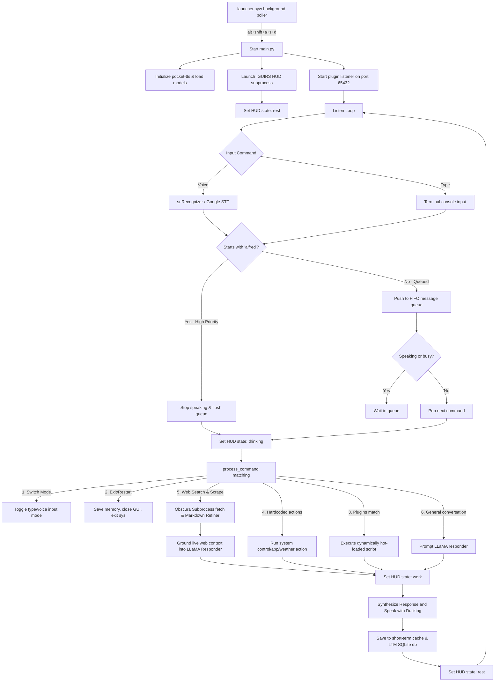

# A.L.F.R.E.D

**Automated Logistics for Facilitating Resources and Executive Duties**

A.L.F.R.E.D is a chat-based, responsive, command-structured automation system powered by locally running pretrained Large Language Models (LLMs). It is designed to function as a background assistant capable of understanding natural language commands and executing system-level actions on Windows.

---

### 📌 Project Overview

A.L.F.R.E.D acts as an intelligent automation layer between the user and the operating system. It combines LLM inference, speech recognition, system control, hotkey-based background execution, an independent GUI rendering HUD with process-isolated multi-window capabilities, and local headless web scraping into a single cohesive workflow.

The project runs entirely locally using GGUF-format models via `llama_cpp`, ensuring privacy and offline functionality.

---

## Key Features

1. **Local LLM Conversations**: Integrates with `llama.cpp` to run local LLaMA GGUF models for private, low-latency conversational responses. Includes dynamic elastic text generation to prevent sentence cut-offs.
2. **Multi-threaded Voice Output**: Leverages [Kyutai's Pocket TTS](https://github.com/kyutai-labs/pocket-tts) model on CPU with sequential playback queueing to deliver high-quality text-to-speech output without blocking main loops.
3. **Voice & Type Inputs**: Speech recognition parses commands via Google STT, with terminal text input support.
4. **FIFO Priority Message Queue & Voice Interrupt**: Sequential FIFO message queue for continuous query execution. Commands starting with the keyword `alfred` receive high-priority preemption—flushing lower-priority queues, instantly cutting speech playback, and executing immediately.
5. **IGUIRS (Independent GUI Rendering System)**:
   - **Direct Frame Streaming Avatar HUD**: Renders real-time animation frames directly from compressed GIF containers across distinct assistant states (`rest`, `listening`, `thinking`, `work`). Frameless, draggable, topmost HUD with live scale reduction (`size_reduce_percentage`) and configurable target FPS via `config.json`.
   - **Process-Isolated Dynamic Windows**: Dynamic secondary windows run in fully isolated child OS processes (`IGUIRS/window_process.py`), preventing secondary window crashes, Tkinter Tcl apartment deadlocks, or video decoding segfaults from affecting the main HUD avatar.
   - **Dynamic Video Engine & Player**: Integrated yt-dlp search with multi-option interactive selector dialog (`VideoSelectorModal`), background stream resolution, frameless 800x600 video window (`DynamicVideoWindow`) locked to audio clock via PyAudio and FFmpeg subprocess, OpenCV-accelerated frame rendering, and automatic garbage collection on stream termination.
   - **Programmatic Controller**: Clean programmatic API (`FILES/gui_controller.py`) for state switching, dynamic window spawning, and config-only resizing.
6. **TurboQuant Vector Quantization Engine**: High-performance vector quantization and codebook operations accelerated via compiled Cython C-extensions (`FILES/turbo_ops.pyx` / `.pyd`).
7. **Enhanced App & Web Launcher**: Space-agnostic registry matching (`$ task manager` / `$taskmanager`) with expanded direct web endpoints including Gemini (`$gemini`), ChatGPT, StackOverflow, Google, and YouTube Music.
8. **Persistent Memory System**: Combines short-term RAM caching of conversation context with a long-term SQLite database using FTS5 (Full-Text Search) and automatic tagging to recall, search, or forget past conversations.
9. **System Automation**: Native desktop control interfaces to adjust volume (via `pycaw`), screen brightness, open/close applications (Notepad, Command Prompt, Chrome, WhatsApp, IDEs), toggle system settings, restart, or shutdown.
10. **Model Context Protocol (MCP) Intermediary Bridge**: Connects ALFRED to the Octopus MCP engine using a dedicated async daemon and synchronous facade, supporting fast-path keyword routing, local Qwen tool classification, and standard stdio external tools.
11. **Real-time Resource Monitoring**: Integrated CPU/RAM stats collector for system status feedback and voice status responses.
12. **Content-Length Bucketed Latency Profiler & Graphical Stats**: Records exact Query-to-Response latency right before speech output. Tracks query and response character lengths side-by-side, grouping records into 5 content-length buckets (`1-100`, `101-250`, `251-500`, `501-1000`, `1001+` chars). Features moving average comparisons against the last 10 queries, terminal ASCII/Unicode visual charts, interactive Tkinter canvas plots (`--plot`), and automatic SVG dashboard exports (`stats.svg`).
13. **Native Log Compression, Batch Archiving & Retrieval**: Custom binary compression (`.compressed_logs` with magic header `ALF1`, CRC32 validation, and zlib level 9 compression). Automatically bundles rotated logs and latency records older than 5–7 days in groups of 5 into structured zip archives (`from_DD_MM_YYYY_to_DD_MM_YYYY_*.zip`). Includes function-specific CLI log querying with automatic file exports and terminal previews.
14. **Smart Audio Ducking**: Automatically detects external audio streams via `pycaw` and ducks volume by 85% during ALFRED speech playback, seamlessly restoring volume upon completion or voice interrupt.
15. **Local Stealth Web Scraper & Knowledge Grounding (Obscura)**:
    - **Ultra-Lightweight Rust Engine**: Embeds [h4ckf0r0day/obscura](https://github.com/h4ckf0r0day/obscura), consuming only ~30–60 MB RAM (compared to 500 MB–1.5 GB for headless Chromium).
    - **V8 JavaScript Execution & Stealth Mode**: Executes dynamic SPAs and client-side scripts with Google's V8 engine while masking automation markers (`navigator.webdriver = undefined`), randomizing browser fingerprints, and blocking >3,500 tracking domains.
    - **Zero Cloud Scraper Dependencies**: Operates 100% locally with zero external scraping API costs (no ScrapingBee, Firecrawl, or BrightData subscriptions needed) and zero telemetry or analytics collection.
    - **Context Refinement & In-Memory Lifecycle**: Converts pages directly to clean hierarchical Markdown, trims navigational bloat, enforces a strict 5,000–7,000 word ceiling for LLaMA 32k context, and discards transient data from memory immediately after response generation with zero disk junk.

---

## File Structure

The project layout organizes files systematically across frontend, plugins framework, and core Python modules:

```
Project/
├── .env                  # Local environment configurations (ignored by git)
├── .gitignore            # Git exclusion guidelines
├── alfred_voice.py       # Multi-threaded Pocket-TTS synthesis module with voice interrupt
├── launcher.pyw          # Background service hotkey and health check poller
├── LICENSE               # MIT License
├── main.py               # Main application entry point with priority queue & GUI lifecycle
├── README.md             # Project documentation
├── requirements.txt      # Python dependencies manifest
├── test_dynamic_gui.py   # Interactive test harness for IGUIRS multi-window & states
├── version.py            # Project constants and network metadata
├── Data/                 # Application data and logs
├── FILES/                # Core Python modules
│   ├── audio_ducker.py   # Smart volume ducking for background audio during speech
│   ├── bin/              # Local standalone binaries
│   │   ├── obscura.exe   # Obscura Rust headless browser engine
│   │   └── obscura-worker.exe # Obscura worker rendering process
│   ├── command_components/ # Modular system command subroutines
│   │   ├── app_launcher.py      # App launch, space-agnostic web registry & lifecycle
│   │   ├── log_commands.py      # Log viewer and compression triggers
│   │   ├── memory_commands.py   # LTM recall, search, and forget commands
│   │   ├── search.py            # Google and web queries
│   │   ├── system_status.py     # Battery, CPU, RAM metrics
│   │   ├── weather_commands.py  # Weather updates via OpenWeather API
│   │   └── web_search_commands.py # Live web search & URL scraper command handler
│   ├── commands.py       # Core mapped system command routines
│   ├── gui_controller.py # Controller interface for IGUIRS HUD & dynamic windows
│   ├── intent.py         # Experimental intent classifier / BERT trainer
│   ├── LATENCY_RECORDER.py # Thread-safe file-based latency profiler & CLI
│   ├── log_compressor.py # Custom binary log compressor (.compressed_logs)
│   ├── logger.py         # Centralized timed rotating daily log handler
│   ├── long_term_memory.py # Standalone SQLite conversation memory database
│   ├── memory.py         # RAM cache / LTM integration layer
│   ├── model_manager.py  # Loader / unloader for local GGUF models
│   ├── plugin_host.py    # Octopus Model Context Protocol (MCP) Bridge adapter
│   ├── resource_monitor.py # System CPU/RAM tracking module
│   ├── scraper.py        # Obscura headless browser driver, link resolver & text refiner
│   ├── system_control.py # Pycaw volume / Screen-brightness control routines
│   ├── turbo_ops.pyd     # Compiled Cython accelerated quantization operations
│   ├── turbo_ops.pyx     # Cython source for TurboQuant vector operations
│   ├── turbo_quant.py    # TurboQuant vector quantization engine
│   ├── util_functions.py # Multi-replace, search tools, microphone listener
│   ├── utils.py          # LLaMA responder loop interface
│   ├── web_search_extractor.py # Web search extractor
│   ├── window_manager.py # pygetwindow layout helper static class
│   └── youtube_player.py # yt-dlp resilient search and stream extraction
├── IGUIRS/               # Independent GUI Rendering System
│   ├── config.json       # Real-time state and dynamic window registry
│   ├── renderer.py       # Main HUD avatar frame streaming renderer & process manager
│   ├── video_engine.py   # Multi-option selector dialog & dynamic video player
│   ├── window_process.py # Isolated child process runner for crash-resilient secondary windows
│   └── Graphics/         # Direct frame streaming assets and animated GIF containers
│       ├── gifs/         # Compiled multi-frame GIF containers (rest, work, thinking, listening)
│       ├── listening/    # Source frame sequence for listening state
│       ├── rest/         # Source frame sequence for rest state
│       ├── thinking/     # Source frame sequence for thinking state
│       └── work/         # Source frame sequence for work state
├── MCP/                  # Octopus Model Context Protocol (MCP) framework (external repo)
└── research/             # MCP deep research and tool development guides
```

---

## Basic Principles

- **Process Isolation**: Dynamic secondary windows operate in dedicated OS processes with independent Tkinter event loops; crashes in video streaming or external decoders cannot terminate the main assistant HUD.
- **Direct Streaming Over Full Buffering**: Animation frames stream directly from container files to eliminate memory spikes and enable instant state changes.
- **Priority-Driven Preemption**: Direct user commands prefixed with `alfred` override background task queues and interrupt ongoing speech immediately.
- **In-Memory Ephemeral Scraping**: Scraped live web data is processed strictly in-memory and purged immediately after response synthesis; zero permanent cached files clutter the filesystem.
- **Optimal Reusability**: Common helpers such as string replacement, audio ducking, and sound synthesis are centralized under `FILES/util_functions.py` and `alfred_voice.py`.
- **Zero-Hardcoding**: Endpoints like `OpenWeatherKey` are sourced dynamically from `.env`.
- **Structured Operations Logging**: Every module utilizes a centralized logger in `FILES/logger.py` writing rotating logs to `logs/alfred.log` at the `DEBUG` level while displaying essential information to the console.

---

## Workflow of the Project



---

## 🌐 Local Headless Web Scraping (Obscura Engine)

ALFRED integrates **Obscura** ([h4ckf0r0day/obscura](https://github.com/h4ckf0r0day/obscura)), an open-source Rust-based headless browser engine, providing real-time live internet awareness to ground the local LLaMA model in up-to-date facts.

### 1. Key Technical Highlights
- **Engine**: Pure Rust implementation compiling down to a standalone binary with embedded Google V8 (`deno_core`) for dynamic DOM tree and JavaScript evaluation.
- **Resource Footprint**: Consumes roughly ~30–60 MB RAM during page load compared to 500 MB–1.5 GB for Chromium/Playwright.
- **Lazy Lifecycle**: Executes as an on-demand single-shot CLI subprocess (`obscura.exe fetch <URL> --dump markdown --stealth -q`). The process terminates immediately upon completion, returning all RAM to the operating system.
- **Built-in Anti-Detection**: Features stealth mode with TLS fingerprint randomization, `navigator.webdriver = undefined` spoofing, and automatic blocking of over 3,500 tracking domains.
- **In-Memory Sanitization**: Content is converted directly into clean hierarchical Markdown, refined to strip navigational boilerplate, capped to 5,000–7,000 words to respect the 32k context LLM budget, and destroyed from memory immediately after synthesis.

### 2. Supported Commands
Trigger real-time web research using natural voice or typed commands:
- `alfred search the web for <topic>`
- `alfred search online for <topic>`
- `alfred search internet for <topic>`
- `alfred browse the web for <query>`
- `alfred look up online <topic>`
- `alfred scrape website <url>`

---

## Independent GUI Rendering System (IGUIRS)

IGUIRS provides an animated visual presence and multi-window streaming display:

### 1. Main HUD Avatar
- Reads animation frames directly from compressed GIF containers in `IGUIRS/Graphics/gifs/`.
- Switches states on demand: `rest`, `listening`, `thinking`, `work`.
- Drag-and-drop repositioning anywhere on screen.
- Config-driven live resizing (`size_reduce_percentage`) without restarts.

### 2. Process-Isolated Secondary Windows
- Secondary windows (such as video playback or user selection dialogs) spawn via `IGUIRS/window_process.py` in separate OS processes.
- Memory and event loops remain isolated: if a video decoder, PyAudio stream, or OpenCV process encounters an unhandled exception or terminates, the main HUD avatar continues rendering seamlessly.
- Automatically cleans up `IGUIRS/config.json` upon window termination and executes explicit Python garbage collection (`gc.collect()`).

### 3. Interactive Testing
Launch the dynamic window test runner to test HUD states and multi-window spawning interactively:
```bash
python test_dynamic_gui.py
```
Supported interactive commands:
- Enter any search query or YouTube URL to spawn a dynamic video window.
- `state <name>`: Switch avatar state (`rest`, `listening`, `thinking`, `work`).
- `resize <win_id> <w> <h>`: Dynamically resize a window via config (e.g. `resize window_1 1024 768`).
- `close <win_id>`: Close and garbage-collect a dynamic window.

---

## Setup & Execution

### 1. Prerequisites
Ensure you have Python 3.10+ (tested on Python 3.12 and 3.14 64-bit) installed.

### 2. Installation
Install the required dependencies:
```bash
pip install -r requirements.txt
```

### 3. Local Model & Obscura Engine Setup
1. **LLaMA GGUF Model**: Place your quantized GGUF model at `FILES/model/model.gguf`.
2. **Obscura Headless Browser**:
   - Download the precompiled Windows release (`obscura-x86_64-windows-stealth.zip`) from the official [h4ckf0r0day/obscura Releases](https://github.com/h4ckf0r0day/obscura/releases).
   - Extract `obscura.exe` and `obscura-worker.exe` into the `FILES/bin/` folder.

### 4. Environment Config
Create a `.env` file in the root directory:
```env
OpenWeatherKey=your-openweather-api-key
```

### 5. Run Launcher
To run ALFRED in the background:
```bash
pythonw launcher.pyw
```
Press `alt+shift+a+s` followed by `d` to summon the interface.

To run the application directly in terminal mode:
```bash
python main.py
```

---

## System Logging & Latency Tracking

### 1. Operations Logging & Function Retrieval (`FILES/log_compressor.py`)
All application executions, requests, socket connections, and exceptions are logged to:
- Console outputs
- **`logs/alfred.log`** (Rotates daily, retains last 5 days of active/compressed logs)
- Rotated logs are automatically compressed to `.compressed_logs` on shutdown via `FILES/log_compressor.py`.
- Files older than 5 days are bundled into groups of 5 in batch zip archives: `from_DD_MM_YYYY_to_DD_MM_YYYY_alfred_log.zip`.

CLI commands:
```bash
# View last 50 lines of latest active log
python .\FILES\log_compressor.py

# Retrieve logs for a specific function/module (terminal preview)
python .\FILES\log_compressor.py --function alfred_voice

# Export all matching logs for a function to a file (creates directories automatically)
python .\FILES\log_compressor.py --function web_search --output logs/exports/search_logs.txt

# Bundle >=5 files older than 5 days into zip archives
python .\FILES\log_compressor.py --archive

# Clean standalone logs older than 5 days
python .\FILES\log_compressor.py --clean
```

### 2. Latency Profiler, Comparison & Graphical Visualization (`FILES/LATENCY_RECORDER.py`)
Latency is captured strictly from user query arrival to response text readiness right before speaking, tracking both query and response lengths. Entries are grouped into 5 content-length buckets:
- `1–100 chars`: Quick status, time/date, acknowledgments.
- `101–250 chars`: Short conversational answers, quick memory recall.
- `251–500 chars`: Standard assistant explanations.
- `501–1000 chars`: Detailed answers and web summaries.
- `1001+ chars`: Multi-paragraph content and deep web research.

CLI commands:
```bash
# Show previous 10 queries, rolling average, and bucket comparative delta metrics
python .\FILES\LATENCY_RECORDER.py --recent

# Display ASCII distribution charts, bucket averages, and sparkline trends
python .\FILES\LATENCY_RECORDER.py --stats

# Open native Tkinter interactive canvas graph window
python .\FILES\LATENCY_RECORDER.py --plot

# Decompress and show records and summaries for a specific date
python .\FILES\LATENCY_RECORDER.py --show 2026-10-30 --lines 20

# Bundle >=5 latency logs older than 7 days into batch zip archives
python .\FILES\LATENCY_RECORDER.py --archive

# List all available recorded dates, compressed archives, and zip bundles
python .\FILES\LATENCY_RECORDER.py --list

# Migrate legacy format logs to new content-length grouped schema
python .\FILES\LATENCY_RECORDER.py --migrate

# Clean up standalone records older than retention period (15 days)
python .\FILES\LATENCY_RECORDER.py --clean
```

---

### System Requirements (Tested On)

- **Operating System**: Windows 11
- **Python Version**: Python 3.14 (64-bit)
- **Architecture**: x86-64 CPU (no discrete GPU strictly required)

---

## 🚀 Recent Improvements & Updates

- **Audio Playback Concurrency & Anti-Deadlock**: Upgraded voice chunk synchronization to reentrant locks (`RLock`) and decoupled speech-finished callbacks and audio ducker volume restoration from internal playback locks, eliminating race condition freezes during voice interruptions.
- **Atomic Configuration Persistence**: Implemented atomic file updates (`.tmp` write followed by `os.replace`) across `gui_controller.py`, `renderer.py`, and `window_process.py`, preventing state corruption or partial reads under high-frequency GUI events.
- **Optimized Low-Latency Video Pipeline**: Streamlined `video_engine.py` format resolution into a single fast pass for audio and video feeds, piped FFmpeg rawvideo frames directly into OpenCV/NumPy memory buffers, and added dynamic clock resynchronization against PyAudio timestamps.
- **LLM Context & Batch Throughput Optimization**: Expanded model context to 32,000 tokens with batched inference (`n_batch=1024`) and TurboQuant KV cache quantization for larger document synthesis without degradation.

---

## ⚖️ Third-Party Notices, Trademarks & Legal Disclaimers

This project incorporates and interfaces with open-source software, standards, and third-party services. All product names, logos, brands, and trademarks are the property of their respective owners.

- **Obscura Headless Browser Engine**:
  - Copyright © 2024–2026 `h4ckf0r0day` and contributors.
  - Licensed under the **Apache License, Version 2.0**.
  - Used as an external, standalone CLI binary for local HTML/DOM rendering and web scraping automation without modifying the upstream source. Upstream project: [github.com/h4ckf0r0day/obscura](https://github.com/h4ckf0r0day/obscura).
- **Pocket TTS**:
  - Developed and open-sourced by **Kyutai Labs** ([Kyutai](https://github.com/kyutai-labs/pocket-tts)).
  - Used for local lightweight neural voice synthesis on CPU.
- **llama.cpp / llama-cpp-python**:
  - Copyright © 2023–2026 Georgi Gerganov and contributors.
  - Licensed under the **MIT License**.
- **DuckDuckGo**:
  - "DuckDuckGo" is a registered trademark of Duck Duck Go, Inc.
  - Query references in this codebase represent nominative fair use to describe publicly available HTML endpoints. This project is not affiliated with, endorsed by, or sponsored by Duck Duck Go, Inc.
- **OpenWeatherMap**:
  - Weather data and forecasts provided by **OpenWeather Ltd**.
  - Usage requires an active user-provided API key subject to the [OpenWeather Terms of Service](https://openweather.co.uk/).
- **Model Context Protocol (MCP)**:
  - Model Context Protocol specification created by **Anthropic, PBC**.
- **Open Source Libraries**:
  - Includes components utilizing OpenCV (Apache 2.0), PyAudio (MIT), yt-dlp (The Unlicense), pycaw (MIT), SpeechRecognition (BSD), and Pygame (LGPL).

> [!IMPORTANT]
> **Web Scraping & Acceptable Use Disclaimer**:
> A.L.F.R.E.D is designed as a personal assistant and automation client. Users are solely responsible for ensuring that all web scraping and research activities performed via Obscura comply with the relevant target websites' Terms of Service, Acceptable Use Policies, applicable copyright laws, and `robots.txt` guidelines. The maintainers of this project do not endorse or encourage unauthorized data harvesting, commercial republishing, or circumvention of access controls.

---

### Disclaimer

This project is intended for educational and experimental purposes. Users are responsible for the commands executed by the system.

---

## License

This project is licensed under the MIT License. See the [LICENSE](LICENSE) file for details.
